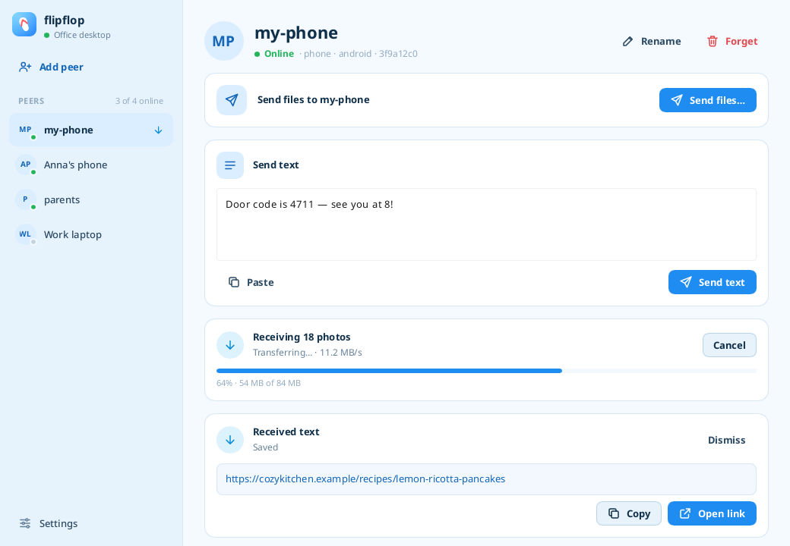

# flipflop

Establish a trusted tunnel between two or more devices: from that point on one can send files to the other anytime.

It works through bluetooth, LAN or even through the wild internet. It uses [Iroh](https://iroh.computer).

Use it to share stuff between all your devices, and maybe devices of your family members, in the same household or afar, sharing links, plain text, anything.



## Download

Get the latest Linux, macOS and Windows builds and the Android APK from the [releases page](https://github.com/andunieee/flipflop/releases/latest).

On Windows, you can either run the executable direclty or use the `-setup.exe` installer.
Because Microsoft hates the world, they will show a "Windows protected your PC" warning when you try.

Because Apple hates the world even more, I can't publish it for iOS.

## Build

```sh
cargo run --release          # desktop
just android-install         # Android (needs cargo-apk, Android SDK + NDK)
```
